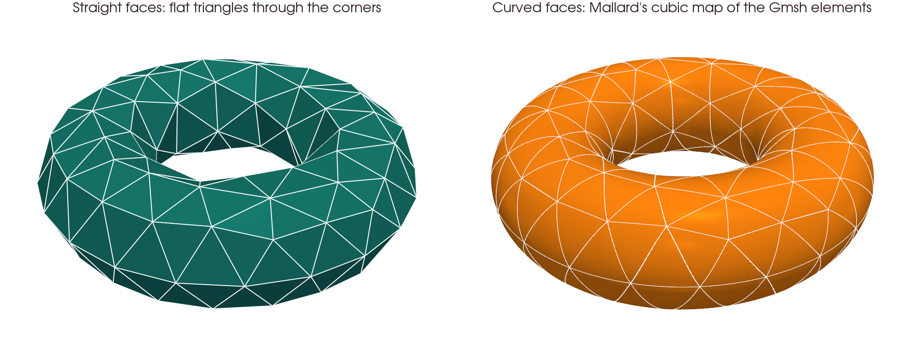
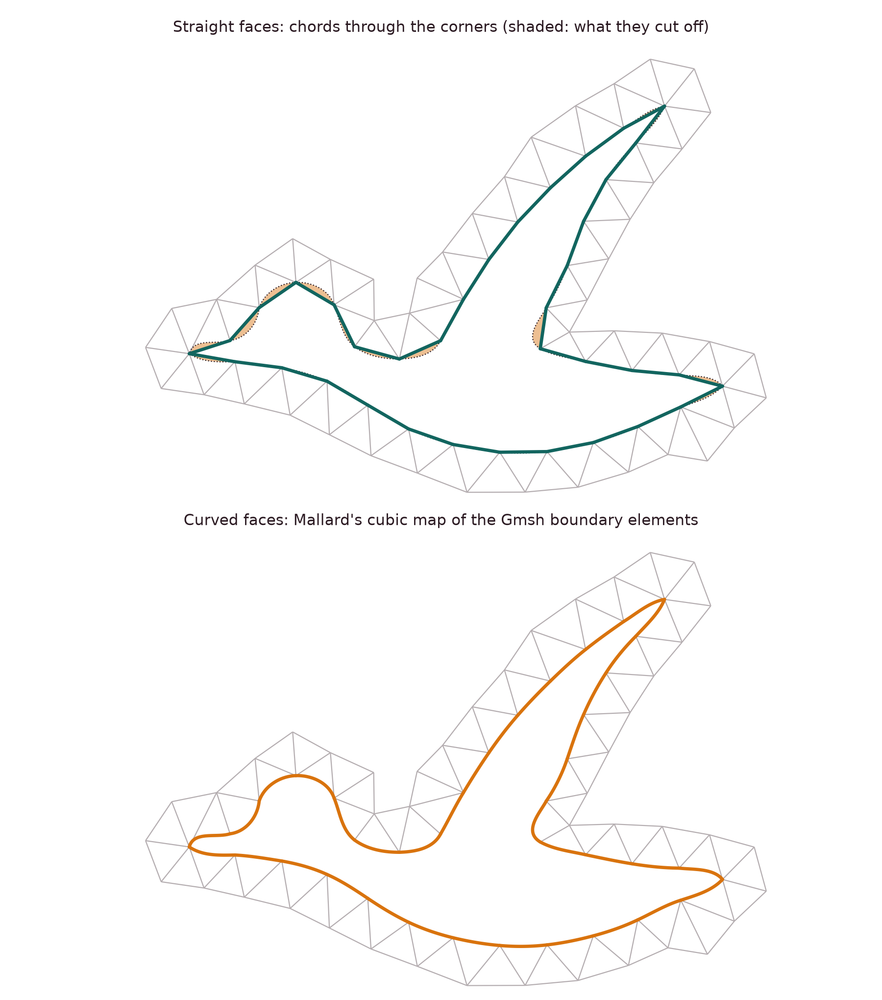
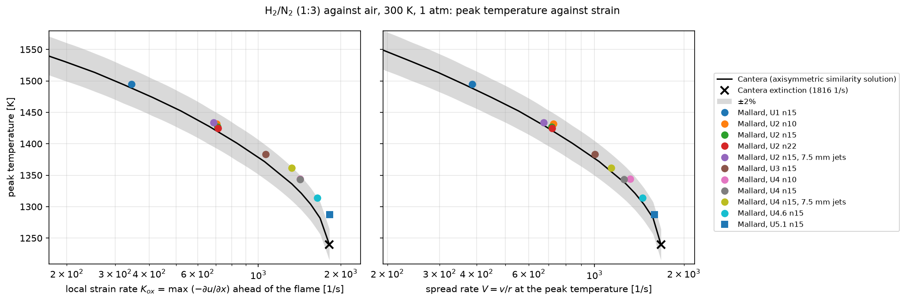

# Gallery

Every case here is one of Mallard's [examples](docs/examples.md). Quantitative comparisons with exact solutions and reference data are on the [validation](validation.md) page.

<figure class="mallard-gallery__feature" id="riemann-4k" markdown>
<video data-autoplay controls loop muted playsinline preload="none" width="1920" height="1080" poster="../media/riemann4k_poster.jpg" aria-label="Density and numerical schlieren of the 2D Riemann problem on 4096 by 4096 quadrilaterals, t = 0 to 0.8"><source src="../media/riemann4k.mp4" type="video/mp4"></video>
<figcaption markdown>**2D Riemann problem, configuration 3, at 4096 × 4096** (Lax & Liu 1998). Four shocks interact, and the slip lines between the quadrants roll up into cascades of Kelvin–Helmholtz vortices that fill the mushroom-shaped jet. [Example: `riemann_2d_quads`](docs/examples.md#riemann-2d-quads)</figcaption>
</figure>

<figure class="mallard-gallery__duo" markdown>

<figcaption markdown>**Details at full resolution**, t = 0.8: the roll-ups inside the jet (left) and along the slip line that runs to the upper right (right), each 1600 × 1400 cells of the 4096² mesh.</figcaption>
</figure>

<figure markdown>
<video data-autoplay controls loop muted playsinline preload="none" width="2100" height="1540" poster="../media/double_mach_poster.jpg" aria-label="Density in the double Mach reflection, t = 0 to 0.2"><source src="../media/double_mach.mp4" type="video/mp4"></video>
<figcaption markdown>**Double Mach reflection.** A Mach 10 shock reflecting off a 30° wedge (Woodward & Colella 1984), t = 0 to 0.2, on 1.84 million triangles. [Example: `double_mach`](docs/examples.md#double-mach)</figcaption>
</figure>

<figure markdown>
<video data-autoplay controls loop muted playsinline preload="none" width="1920" height="1080" poster="../media/tgv_poster.jpg" aria-label="Q-criterion isosurfaces of the Taylor-Green vortex at 256 cubed, beside the dissipation rate against the spectral DNS and the 128 cubed run"><source src="../media/tgv.mp4" type="video/mp4"></video>
<figcaption markdown>**Taylor–Green vortex at Re = 1600 on the full periodic box**, 256³ (16.8 million hexahedra), fifth-order TENO-E: Q-criterion isosurfaces colored by vorticity magnitude, and the dissipation rate tracing the 512³ spectral DNS (peak within 0.3%) beside the 128³ run. [Example: `taylor_green_3d`](docs/examples.md#taylor-green-3d) · [validation](validation.md#taylor-green-vortex)</figcaption>
</figure>

<figure id="curved-boundaries" markdown>
{ loading=lazy width=2000 height=760 .mallard-gallery__plot }
<figcaption markdown>**Curved boundaries in 3D.** A coarse torus of cubic triangles: flat faces through their corners (left) and the faces Mallard maps from the high-order elements (right), which follow the surface. New in Mallard 0.8.0. [Validation details](validation.md#curved-boundaries).</figcaption>
</figure>

<figure class="mallard-gallery__pair" id="curved-boundaries-2d" markdown>
{ loading=lazy width=1800 height=2040 .mallard-gallery__plot }
<figcaption markdown>**Curved boundaries in 2D.** The `mallard` example's outline meshed coarse with cubic Gmsh elements; only the wall cells are drawn. Top: chords through the corners, which cut off the shaded slivers at the bill, head, wing tip and tail. Bottom: Mallard's curved faces, which follow the outline. [Validation details](validation.md#curved-boundaries).</figcaption>
</figure>

<figure id="isotropic-turbulence" markdown>
<video data-autoplay controls loop muted playsinline preload="none" width="1920" height="1080" poster="../media/isotropic_turbulence_poster.jpg" aria-label="Q-criterion isosurfaces of decaying compressible isotropic turbulence colored by dilatation, a dilatation slice, and enstrophy and dilatation variance against Johnsen et al."><source src="../media/isotropic_turbulence.mp4" type="video/mp4"></video>
<figcaption markdown>**Decaying compressible isotropic turbulence, in 3D.** The case of Johnsen et al. (2010), turbulent Mach number 0.6 and Reλ = 100, with eddy shocklets. [Example: `isotropic_turbulence`](docs/examples.md#isotropic-turbulence) · [validation](validation.md#isotropic-turbulence)</figcaption>
</figure>

<figure markdown>
<video data-autoplay controls loop muted playsinline preload="none" width="1920" height="1080" poster="../media/sphere_poster.jpg" aria-label="Mach 3 flow over a sphere: Mach number on the horizontal meridian, numerical schlieren on the vertical one and the revolved bow shock, with the standoff distance against Billig's correlation and the stagnation-line pressure"><source src="../media/sphere.mp4" type="video/mp4"></video>
<figcaption markdown>**Mach 3 flow over a sphere, in 3D.** Mach number on the horizontal meridian, numerical schlieren on the vertical one, and the revolved bow shock. [Example: `sphere_mach3`](docs/examples.md#sphere-mach3) · [validation](validation.md#mach-3-sphere)</figcaption>
</figure>

<figure markdown>
<video data-autoplay controls loop muted playsinline preload="none" width="1920" height="1080" poster="../media/sphere_re300_poster.jpg" aria-label="Q-criterion isosurfaces of the hairpin vortices shed by a sphere at Re = 300, colored by streamwise velocity, with drag and lift histories"><source src="../media/sphere_re300.mp4" type="video/mp4"></video>
<figcaption markdown>**Sphere at Re = 300, in 3D.** Periodic shedding of hairpin vortices from a wake with one plane of symmetry: smoothed Q-criterion isosurfaces (Q = 0.02 (U/D)²) colored by streamwise velocity, and the drag and lift coefficients. [Example: `sphere_re300`](docs/examples.md#sphere-re300) · [validation](validation.md#sphere-re300)</figcaption>
</figure>

<figure id="pulsed-jet" markdown>
<video data-autoplay controls loop muted playsinline preload="none" width="1920" height="1080" poster="../media/pulsed_jet_poster.jpg" aria-label="Azimuthal vorticity of a pulsed round jet launching a train of vortex rings, with the rings' core positions and the inlet velocity against its target"><source src="../media/pulsed_jet.mp4" type="video/mp4"></video>
<figcaption markdown>**Pulsed jet launching vortex rings** (axisymmetric, ReD = 2000). A `mass_flow_inlet` whose mass flux is an expression of the radius and time ejects a slug of L / D = 3 per period, below the formation number, and each slug rolls up into a vortex ring. The first ring travels at 0.40 U0, the rings in its wake at 0.46 U0, with 1.01–1.11 times the circulation of the slug model; 442,368 quadrilaterals (D / 96). [Example: `pulsed_jet`](docs/examples.md#pulsed-jet)</figcaption>
</figure>

<figure id="shock-bubble" markdown>
<video data-autoplay controls loop muted playsinline preload="none" width="1920" height="1080" poster="../media/shock_bubble_3d_poster.jpg" aria-label="Helium surface and vortex ring of a shock-accelerated helium bubble, numerical schlieren on the symmetry plane and interface positions against Haas and Sturtevant"><source src="../media/shock_bubble_3d.mp4" type="video/mp4"></video>
<figcaption markdown>**Shock–helium bubble interaction, in 3D** (Haas & Sturtevant 1987). A Mach 1.25 shock in air hits a helium bubble, which rolls up into a vortex ring: the helium surface, the vortex sheet and ring colored by helium fraction, and numerical schlieren on the symmetry plane. [Example: `shock_bubble_3d`](docs/examples.md#shock-bubble-3d) · [validation](validation.md#shock-bubble)</figcaption>
</figure>

<figure markdown>
<video data-autoplay controls loop muted playsinline preload="none" width="1920" height="1080" poster="../media/sedov_poster.jpg" aria-label="Density of the Sedov-Taylor blast wave on three symmetry planes, with the shock radius and density profile against the exact similarity solution"><source src="../media/sedov.mp4" type="video/mp4"></video>
<figcaption markdown>**Sedov–Taylor blast wave, in 3D.** A point explosion: density on the three symmetry planes of the computed octant, the shock radius against the exact similarity solution, and the radial density profile. [Example: `sedov_3d`](docs/examples.md#sedov-3d) · [validation](validation.md#sedov-taylor)</figcaption>
</figure>

<figure markdown>
<video data-autoplay controls loop muted playsinline preload="none" width="1920" height="1080" poster="../media/detonation_2d_poster.jpg" aria-label="Pressure and numerical soot foil of a cellular detonation in hydrogen-oxygen-argon"><source src="../media/detonation_2d.mp4" type="video/mp4"></video>
<figcaption markdown>**Cellular detonation.** A detonation in 2H2–O2–7Ar at 6.67 kPa, started from its ZND structure with six seeded pockets of fresh gas, in a 6 cm channel: pressure, and the numerical soot foil (the peak pressure of each cell), on which triple points trace the detonation cells. [Example: `detonation_2d`](docs/examples.md#detonation-2d) · [validation](validation.md#cellular-detonation)</figcaption>
</figure>

<figure id="detonation-3d" markdown>
<video data-autoplay controls loop muted playsinline preload="none" width="1920" height="1080" poster="../media/detonation_3d_poster.jpg" aria-label="Leading shock of a cellular detonation in a square duct colored by the pressure behind it, and the numerical soot foils of the four walls"><source src="../media/detonation_3d.mp4" type="video/mp4"></video>
<figcaption markdown>**Cellular detonation in 3D.** The 2H2–O2–7Ar detonation of the 2D case in a 3 cm square duct: the leading shock colored by the pressure behind it, and the numerical soot foils of the four walls. [Example: `detonation_3d`](docs/examples.md#detonation-3d) · [validation](validation.md#cellular-detonation-3d)</figcaption>
</figure>

<figure markdown>
<video data-autoplay controls loop muted playsinline preload="none" width="1920" height="1080" poster="../media/flame_2d_poster.jpg" aria-label="Temperature of a lean hydrogen-air flame with mixture-averaged and unity Lewis number transport, and the consumption speed"><source src="../media/flame_2d.mp4" type="video/mp4"></video>
<figcaption markdown>**Differential diffusion in a lean H2/air flame.** φ = 0.4, 700 K, 1 atm, from the same initial wrinkle with mixture-averaged transport (left) and unity Lewis numbers (right): with mixture-averaged transport the burnt gas behind the bulges is superadiabatic (up to 1.017 Tad) and the flame burns faster; with unity Lewis numbers it stays within 0.4% of Tad. [Example: `flame_2d`](docs/examples.md#flame-2d) · [validation](validation.md#lean-flame)</figcaption>
</figure>

<figure class="mallard-gallery__pair" id="counterflow-flame" markdown>
<video data-autoplay controls loop muted playsinline preload="none" width="1000" height="520" poster="../media/counterflow_poster.jpg" aria-label="Temperature and streamlines of a counterflow diffusion flame blown out at high strain, with the peak temperature over time"><source src="../media/counterflow.mp4" type="video/mp4"></video>
<figcaption markdown>**Counterflow diffusion flame and extinction, in 3D.** H2/N2 (1:3) against air at 300 K and 1 atm, from opposed round jets 10 mm apart with N2 coflows, on a quarter domain of 46,464 hexahedra (15 cells per flame width), against Cantera's `CounterflowDiffusionFlame`. [Example: `counterflow_diffusion`](docs/examples.md#counterflow-diffusion)</figcaption>
</figure>

<figure markdown>
{ loading=lazy width=2053 height=683 .mallard-gallery__plot }
<figcaption markdown>Peak temperature against strain: within 2% of Cantera from 344 to 1640 1/s at matched local strain rate (up to 90% of the extinction strain), and within 1.1% at matched spread rate.</figcaption>
</figure>

<figure id="triple-flame" markdown>
<video data-autoplay controls loop muted playsinline preload="none" width="1920" height="1080" poster="../media/triple_flame_poster.jpg" aria-label="Heat release and streamlines of triple flames in hydrogen/air mixing layers of two thicknesses, and their propagation speed over time"><source src="../media/triple_flame.mp4" type="video/mp4"></video>
<figcaption markdown>**Triple flames** (Ruetsch, Vervisch & Liñán 1995). H2:N2 = 1:1 against air at 300 K and 1 atm, in inlet mixing layers 4 and 12 thermal thicknesses thick, with detailed chemistry and mixture-averaged transport; the inflow is raised to the flame's speed to hold it in place. [Example: `triple_flame`](docs/examples.md#triple-flame)</figcaption>
</figure>

<figure id="flame-vortex" markdown>
<video data-autoplay controls loop muted playsinline preload="none" width="1920" height="1080" poster="../media/flame_vortex_poster.jpg" aria-label="Temperature of eleven premixed flame-vortex interactions, their place on the spectral diagram and their heat release over time"><source src="../media/flame_vortex.mp4" type="video/mp4"></video>
<figcaption markdown>**Premixed flame–vortex interactions** on the spectral diagram of Poinsot, Veynante & Candel (1991). [Example: `flame_vortex`](docs/examples.md#flame-vortex)</figcaption>
</figure>

<figure id="flame-vortex-quenching" markdown>
<video data-autoplay controls loop muted playsinline preload="none" width="1920" height="1080" poster="../media/flame_vortex_quenching_poster.jpg" aria-label="A vortex pair against a radiating lean methane flame at phi 0.42 and 0.44 and an adiabatic one: the pocket quenches only in the strongest losses"><source src="../media/flame_vortex_quenching.mp4" type="video/mp4"></video>
<figcaption markdown>**Flame–vortex quenching by radiative heat loss.** A vortex pair (r = 4 δL, u′ = 30 SL) cuts a pocket of fresh gas out of a lean CH4/air flame near its radiative limit (φ = 0.42), and the pocket goes out in burnt gas that radiation has cooled. [Example: `flame_vortex_quenching`](docs/examples.md#flame-vortex-quenching) · [validation](validation.md#flame-vortex-quenching)</figcaption>
</figure>

<figure markdown>
<video data-autoplay controls loop muted playsinline preload="none" width="2100" height="1912" poster="../media/viscous_shock_tube_poster.jpg" aria-label="Density in the viscous shock tube, t = 0 to 1"><source src="../media/viscous_shock_tube.mp4" type="video/mp4"></video>
<figcaption markdown>**Viscous shock tube** (Daru & Tenaud 2009), Re = 200. [Example: `viscous_shock_tube`](docs/examples.md#viscous-shock-tube) · [validation](validation.md#viscous-shock-tube)</figcaption>
</figure>

<figure markdown>
<video data-autoplay controls loop muted playsinline preload="none" width="2100" height="1306" poster="../media/mallard_poster.jpg" aria-label="Mach number of Mach 8 flow over a flying mallard, t = 0 to 0.75"><source src="../media/mallard.mp4" type="video/mp4"></video>
<figcaption markdown>**Mach 8 flow over a mallard.** Inviscid flow over the silhouette of a flying mallard (body length about 1.1), started impulsively: bow shocks form off the bill, head and wing, merge, and the wake rolls up behind the tail. [Example: `mallard`](docs/examples.md#mallard)</figcaption>
</figure>

